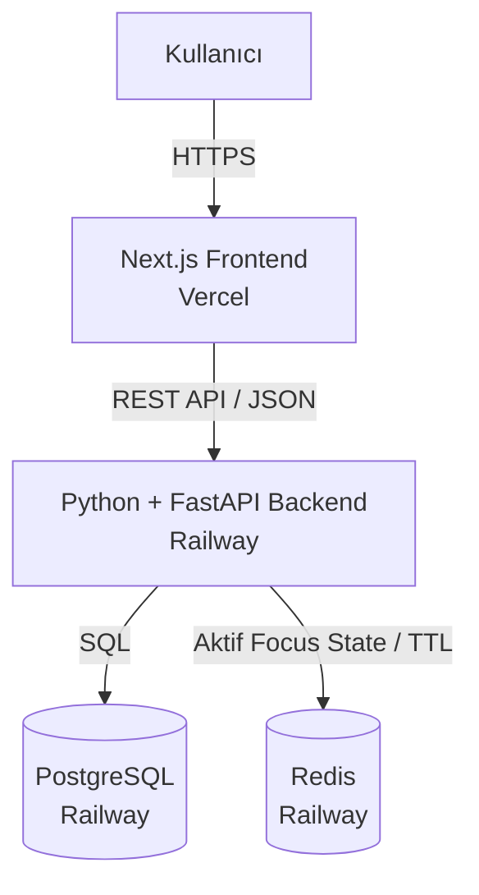
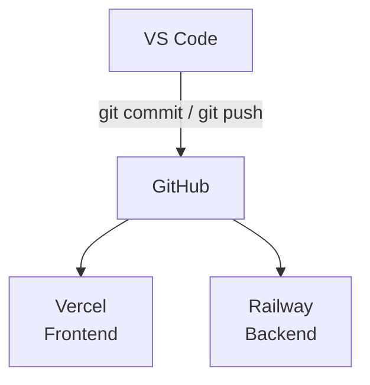

# FocusTrack

FocusTrack, görev yönetimi ve odak süresi takibi için geliştirilmiş full-stack bir web uygulamasıdır.

Proje; frontend, backend, veritabanı, authentication, Redis, Docker, Git/GitHub ve deployment süreçlerini uçtan uca deneyimlemek amacıyla geliştirilmiştir.

## Özellikler

- Kullanıcı kayıt ve giriş işlemleri
- JWT tabanlı authentication
- Görev oluşturma, listeleme, düzenleme ve silme
- Görev durumunu değiştirme
- Görev önceliği belirleme
- 25 dakikalık odak oturumu başlatma
- Sayfa yenilendiğinde devam eden focus timer
- Günlük toplam odak süresini görüntüleme
- Son odak oturumlarını görüntüleme

## Kullanılan Teknolojiler

### Frontend

- Next.js
- React
- TypeScript
- Tailwind CSS

### Backend

- Python
- FastAPI
- JWT (PyJWT)
- bcrypt

### Veri Katmanı

- PostgreSQL
- Redis

### Development ve Deployment

- Docker
- Docker Compose
- Git
- GitHub
- Railway
- Vercel

## Proje Yapısı

```text
focustrack/
├── backend/
│   ├── server.py
│   ├── db.py
│   ├── redis_client.py
│   ├── init.sql
│   ├── init_db.py
│   ├── requirements.txt
│   └── Dockerfile
│
├── frontend/
│   └── app/
│       ├── page.tsx
│       ├── login/
│       ├── register/
│       └── dashboard/
│
├── docs/
│   └── ARCHITECTURE.md
│
├── docker-compose.yml
└── README.md
```

## Genel Mimari



Frontend doğrudan PostgreSQL veya Redis'e erişmez.

Tüm işlemler REST API üzerinden backend'e gönderilir.

- PostgreSQL kalıcı veriler için kullanılır.
- Redis aktif focus oturumu gibi geçici veriler için kullanılır.

Detaylı uygulama akışı ve servis mimarisi için:

[Architecture Documentation](docs/ARCHITECTURE.md)

## Temel API Endpoint'leri

| Method | Endpoint | Açıklama |
|---|---|---|
| POST | `/register` | Kullanıcı oluşturur |
| POST | `/login` | Kullanıcı girişi ve JWT üretimi |
| GET | `/tasks` | Kullanıcının görevlerini getirir |
| POST | `/tasks` | Yeni görev oluşturur |
| PUT | `/tasks/:id` | Görevi günceller |
| DELETE | `/tasks/:id` | Görevi siler |
| POST | `/focus/start/:taskId` | Focus oturumu başlatır |
| GET | `/focus` | Aktif focus bilgisini getirir |
| DELETE | `/focus` | Focus oturumunu durdurur |
| GET | `/focus/history` | Focus geçmişini getirir |

## Authentication

Kullanıcı şifreleri PostgreSQL'e açık metin olarak kaydedilmez.

Register işlemi sırasında şifreler `bcrypt` kullanılarak hashlenir.

Login başarılı olduğunda backend bir JWT oluşturur.

Frontend sonraki korunan API isteklerinde token'ı aşağıdaki formatta gönderir:

```text
Authorization: Bearer <JWT>
```

Backend JWT'yi doğrulayarak işlemin hangi kullanıcı tarafından yapıldığını belirler.

## Redis Kullanımı

Redis aktif 25 dakikalık focus oturumunun geçici durumunu tutmak için kullanılır.

Örnek Redis key:

```text
focus:user:<userId>
```

Focus oturumu için:

```text
TTL = 1500 saniye
```

kullanılır.

Bu sayede kullanıcı sayfayı yenilese bile backend Redis'teki kalan TTL değerini okuyarak focus timer'ın kaldığı yerden devam etmesini sağlar.

## PostgreSQL Kullanımı

PostgreSQL kalıcı uygulama verileri için kullanılır.

Temel tablolar:

```text
users
tasks
focus_sessions
```

- `users`: kullanıcı bilgileri
- `tasks`: kullanıcı görevleri
- `focus_sessions`: tamamlanan veya başlatılan focus oturumları

## Lokal Çalıştırma

### Gereksinimler

- Git
- Node.js ve npm (frontend için)
- Docker Desktop

Projeyi klonlayın:

```bash
git clone <repository-url>
cd focustrack
```

Backend, PostgreSQL ve Redis servislerini Docker Compose ile başlatın:

```bash
docker compose up -d --build
```

Çalışan container'ları kontrol etmek için:

```bash
docker ps
```

Frontend klasörüne geçin:

```bash
cd frontend
```

Gerekli paketleri yükleyin:

```bash
npm install
```

Frontend'i başlatın:

```bash
npm run dev
```

Frontend varsayılan olarak:

```text
http://localhost:3000
```

adresinde çalışır.

Backend ise lokal ortamda:

```text
http://localhost:5000
```

adresinden erişilebilir.

## Frontend Environment Variable

Lokal frontend için `frontend/.env.local` dosyasında:

```env
NEXT_PUBLIC_API_URL=http://localhost:5000
```

tanımlanır.

Production ortamında bu değişken Railway üzerindeki backend adresini gösterir.

## Production

Production ortamındaki servis dağılımı:

| Servis | Platform |
|---|---|
| Next.js Frontend | Vercel |
| Python / FastAPI Backend | Railway |
| PostgreSQL | Railway |
| Redis | Railway |

Production akışı:

```text
Kullanıcı
   ↓
Vercel / Next.js
   ↓
Railway / FastAPI
   ↓
PostgreSQL + Redis
```

Backend production ortamında aşağıdaki environment variable'ları kullanır:

```text
DATABASE_URL
REDIS_URL
JWT_SECRET
```

Frontend ise:

```text
NEXT_PUBLIC_API_URL
```

değişkeni üzerinden backend'e bağlanır.

Secret bilgiler repository içerisinde tutulmaz.

## Deployment

Kaynak kod GitHub üzerinde tutulur.

Deployment akışı:



Repository içerisinde hem frontend hem backend bulunduğu için proje monorepo yapısındadır.

Deployment sırasında:

```text
Vercel Root Directory  = frontend
Railway Root Directory = /backend
```

olarak yapılandırılmıştır.

## Veritabanı Initialization

Production PostgreSQL ilk oluşturulduğunda boş olduğu için gerekli tablolar:

```text
backend/init.sql
```

dosyasında tanımlanmıştır.

Bu SQL dosyasını çalıştırmak için:

```text
backend/init_db.py
```

scripti kullanılır (Python).

Railway üzerinde Pre-deploy Command:

```bash
python init_db.py
```

olarak yapılandırılmıştır.

## Dokümantasyon

Daha detaylı sistem mimarisi, servis dağılımı ve veri akışları için:

[docs/ARCHITECTURE.md](docs/ARCHITECTURE.md)
