# FocusTrack Architecture

Bu doküman FocusTrack uygulamasının teknik mimarisini, servis dağılımını, servisler arasındaki iletişimi ve temel uygulama akışlarını açıklamaktadır.

---

## 1. Genel Mimari

FocusTrack frontend, backend ve veri katmanlarının birbirinden ayrıldığı bir mimari ile geliştirilmiştir.

Production ortamındaki genel yapı:

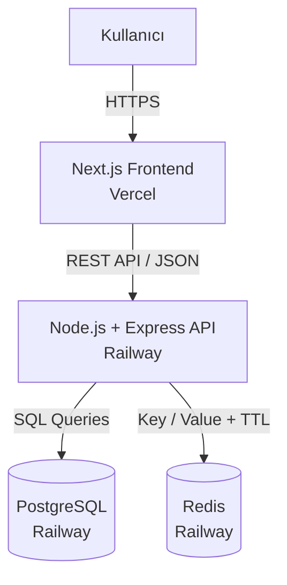

Temel iletişim akışı:

```text
Kullanıcı
   ↓
Frontend
   ↓
REST API
   ↓
Backend
   ↓
PostgreSQL / Redis
```

Frontend hiçbir zaman doğrudan PostgreSQL veya Redis'e bağlanmaz.

Veri erişimi ve iş mantığı backend üzerinden yönetilir.

---

## 2. Servis Dağılımı

| Servis | Teknoloji | Production Ortamı | Sorumluluk |
|---|---|---|---|
| Frontend | Next.js / TypeScript | Vercel | Kullanıcı arayüzü |
| Backend | Node.js / Express | Railway | REST API ve iş mantığı |
| Database | PostgreSQL | Railway | Kalıcı veriler |
| Temporary State | Redis | Railway | Aktif focus oturumu |
| Repository | Git / GitHub | GitHub | Kaynak kod ve versiyon kontrolü |

---

## 3. Frontend Katmanı

Frontend Next.js, React ve TypeScript kullanılarak geliştirilmiştir.

Temel route yapısı:

```text
frontend/app/
├── page.tsx
├── login/
│   └── page.tsx
├── register/
│   └── page.tsx
└── dashboard/
    └── page.tsx
```

Frontend'in temel sorumlulukları:

- Kullanıcı arayüzünü göstermek
- Kullanıcıdan form verilerini almak
- Backend REST API'ye request göndermek
- Backend response'larını kullanıcıya göstermek
- JWT token'ını tarayıcıda saklamak
- Görevleri ekranda göstermek
- Aktif focus timer'ını göstermek
- Focus geçmişini göstermek

Frontend backend adresini environment variable üzerinden alır:

```text
NEXT_PUBLIC_API_URL
```

Lokal ortam:

```env
NEXT_PUBLIC_API_URL=http://localhost:5000
```

Production ortam:

```text
NEXT_PUBLIC_API_URL=https://<railway-backend-domain>
```

---

## 4. Backend Katmanı

Backend Node.js ve Express kullanılarak geliştirilmiştir.

Ana backend dosyası:

```text
backend/server.js
```

Backend'in temel sorumlulukları:

- Kullanıcı kayıt işlemleri
- Kullanıcı authentication
- JWT üretme ve doğrulama
- Şifre hashleme
- Task CRUD işlemleri
- PostgreSQL erişimi
- Redis erişimi
- Focus oturumlarının yönetimi
- Kullanıcı bazlı yetkilendirme

Temel endpoint'ler:

| Method | Endpoint | Görev |
|---|---|---|
| POST | `/register` | Yeni kullanıcı oluşturma |
| POST | `/login` | Kullanıcı girişi |
| GET | `/tasks` | Görevleri listeleme |
| POST | `/tasks` | Görev oluşturma |
| PUT | `/tasks/:id` | Görev güncelleme |
| DELETE | `/tasks/:id` | Görev silme |
| POST | `/focus/start/:taskId` | Focus başlatma |
| GET | `/focus` | Aktif focus bilgisini alma |
| DELETE | `/focus` | Focus durdurma |
| GET | `/focus/history` | Focus geçmişini alma |

---

## 5. Genel Request / Response Akışı

Kullanıcının yaptığı işlemler frontend tarafından backend API'ye gönderilir.

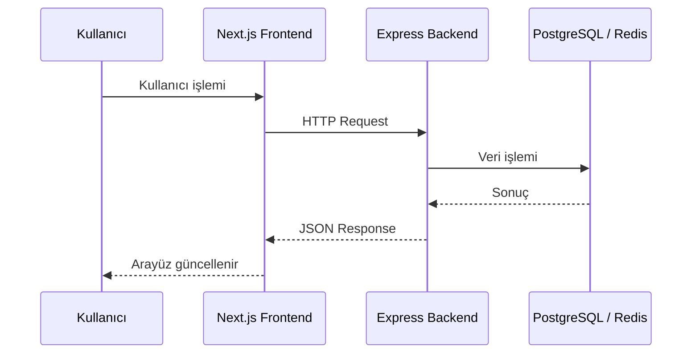

Backend response'ları JSON formatında frontend'e gönderilir.

---

## 6. Kullanıcı Kayıt Akışı

Kullanıcı register ekranında isim, e-posta ve şifre bilgilerini girer.

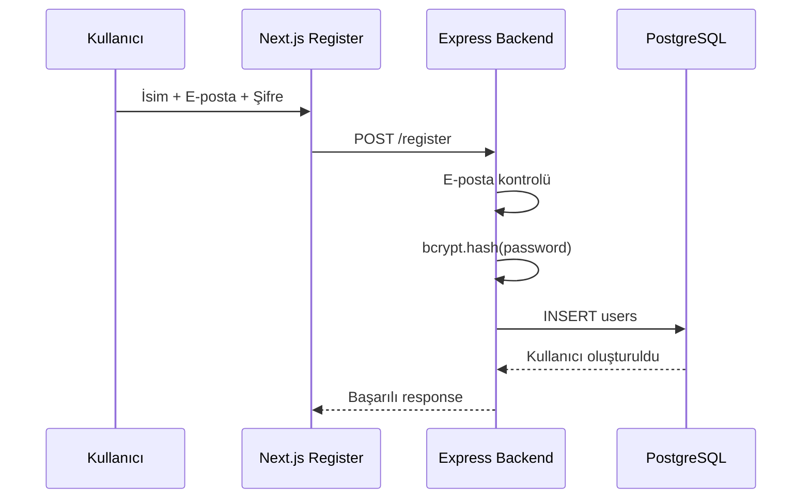

Şifre PostgreSQL'e açık metin olarak kaydedilmez.

Backend şifreyi:

```text
bcrypt
```

ile hashledikten sonra `users` tablosuna kaydeder.

Kayıt tamamlandıktan sonra frontend otomatik login işlemi gerçekleştirir.

---

## 7. Login ve JWT Akışı

Login sırasında kullanıcı e-posta ve şifresini frontend üzerinden gönderir.

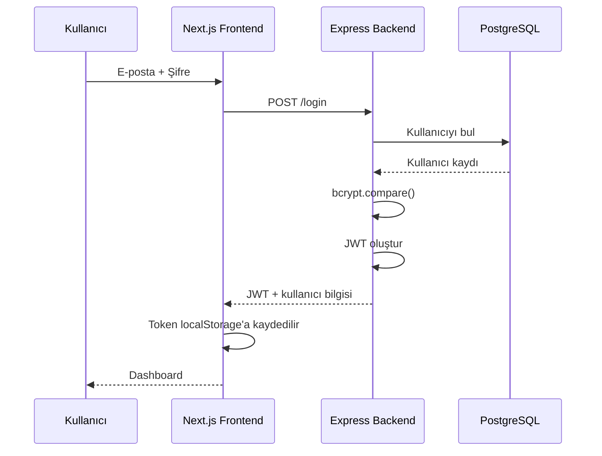

JWT içerisinde kullanıcıyı belirlemek için gerekli bilgiler tutulur.

Frontend JWT'yi tarayıcıdaki `localStorage` içerisinde saklar.

Korunan endpoint'lere yapılan isteklerde token:

```text
Authorization: Bearer <JWT>
```

şeklinde gönderilir.

---

## 8. Authentication Middleware

Korunan endpoint'lerde backend doğrudan işlemi çalıştırmaz.

Önce JWT doğrulanır.

```text
Frontend Request
      ↓
Authorization Header
      ↓
authenticateToken
      ↓
JWT geçerli mi?
      ↓
userId belirlenir
      ↓
Endpoint çalışır
```

Bu işlem:

```text
backend/server.js
```

içerisindeki authentication middleware tarafından gerçekleştirilir.

Bu sayede backend isteği yapan kullanıcının kim olduğunu bilir.

---

## 9. Task CRUD Akışı

FocusTrack görev yönetimi için CRUD yapısını kullanır.

CRUD:

```text
Create
Read
Update
Delete
```

API karşılıkları:

| CRUD | HTTP Method | Endpoint |
|---|---|---|
| Create | POST | `/tasks` |
| Read | GET | `/tasks` |
| Update | PUT | `/tasks/:id` |
| Delete | DELETE | `/tasks/:id` |

### Task Oluşturma

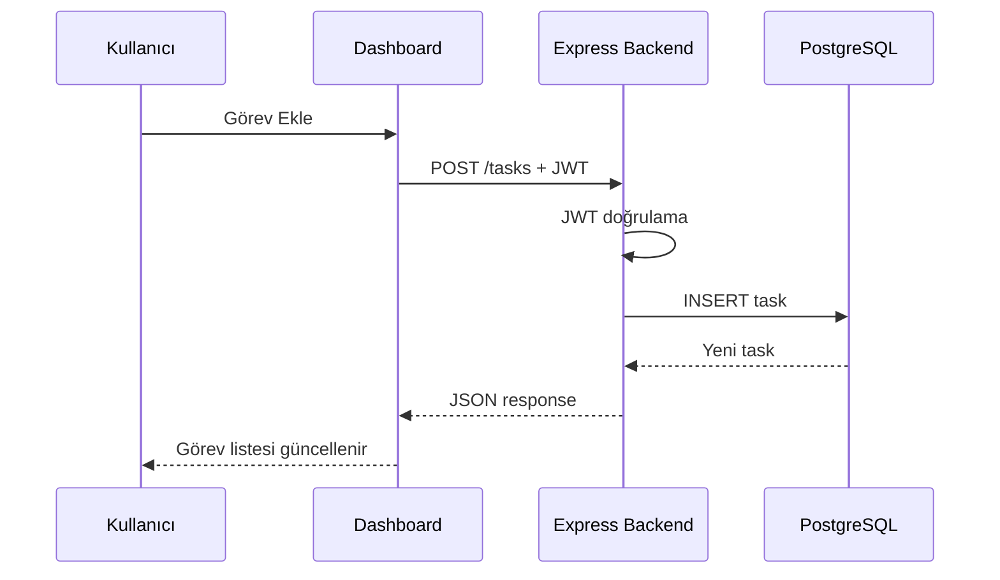

Task kayıtları kullanıcıya bağlıdır.

Backend sorgularında:

```text
user_id
```

kontrolü yapılır.

Bu sayede kullanıcı yalnızca kendi görevlerini görüntüleyebilir, güncelleyebilir veya silebilir.

---

## 10. PostgreSQL Katmanı

PostgreSQL uygulamanın kalıcı veri katmanıdır.

Bağlantı:

```text
backend/db.js
```

dosyasında oluşturulur.

Node.js tarafında PostgreSQL bağlantısı için:

```text
pg
```

paketi kullanılmaktadır.

Temel tablolar:

```text
users
tasks
focus_sessions
```

### users

Kullanıcı bilgilerini tutar.

Temel alanlar:

```text
id
name
email
password
created_at
```

### tasks

Görevleri tutar.

Temel alanlar:

```text
id
user_id
title
description
status
priority
due_date
created_at
```

### focus_sessions

Focus geçmişini tutar.

Temel alanlar:

```text
id
user_id
task_id
started_at
ended_at
duration_seconds
```

Tablolar:

```text
backend/init.sql
```

dosyasında tanımlanmıştır.

---

## 11. Veritabanı İlişkileri

Görevler kullanıcıya bağlıdır.

```text
users
  |
  | 1
  |
  | N
tasks
```

`tasks.user_id` alanı:

```text
users.id
```

alanına foreign key ile bağlıdır.

Focus session kayıtları da kullanıcı ve task bilgileriyle ilişkilidir.

```text
users
  |
  +------ focus_sessions
              |
              |
             tasks
```

Bu ilişkiler PostgreSQL tarafında foreign key yapıları ile oluşturulmuştur.

---

## 12. Redis Katmanı

Redis aktif focus oturumunun geçici state'ini tutmak için kullanılır.

Redis bağlantısı:

```text
backend/redis.js
```

dosyasında oluşturulur.

Redis key formatı:

```text
focus:user:<userId>
```

Örnek:

```text
focus:user:5
```

Value içerisinde aşağıdaki bilgiler bulunabilir:

```text
taskId
sessionId
startedAt
```

Focus key için:

```text
TTL = 1500 saniye
```

yani:

```text
25 dakika
```

kullanılır.

---

## 13. Focus Başlatma Akışı

Kullanıcı dashboard üzerinde bir task için "Odaklan" butonuna bastığında:

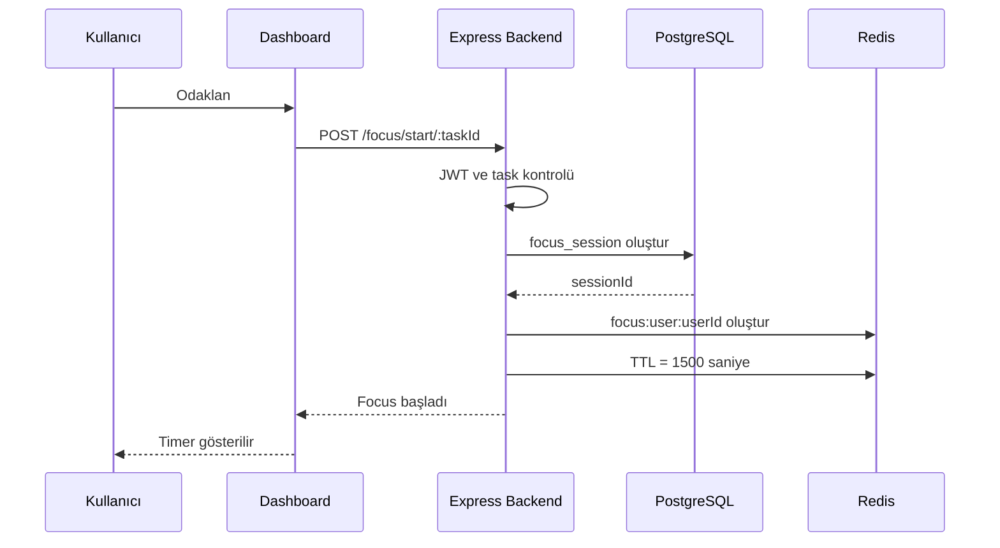

Burada PostgreSQL ve Redis farklı sorumluluklara sahiptir.

PostgreSQL:

```text
Kalıcı focus geçmişi
```

Redis:

```text
Aktif focus state
Kalan süre
TTL
```

için kullanılır.

---

## 14. Sayfa Yenilendiğinde Focus Akışı

Timer yalnızca frontend üzerindeki React state içerisinde tutulmaz.

Kullanıcı sayfayı yenilediğinde:

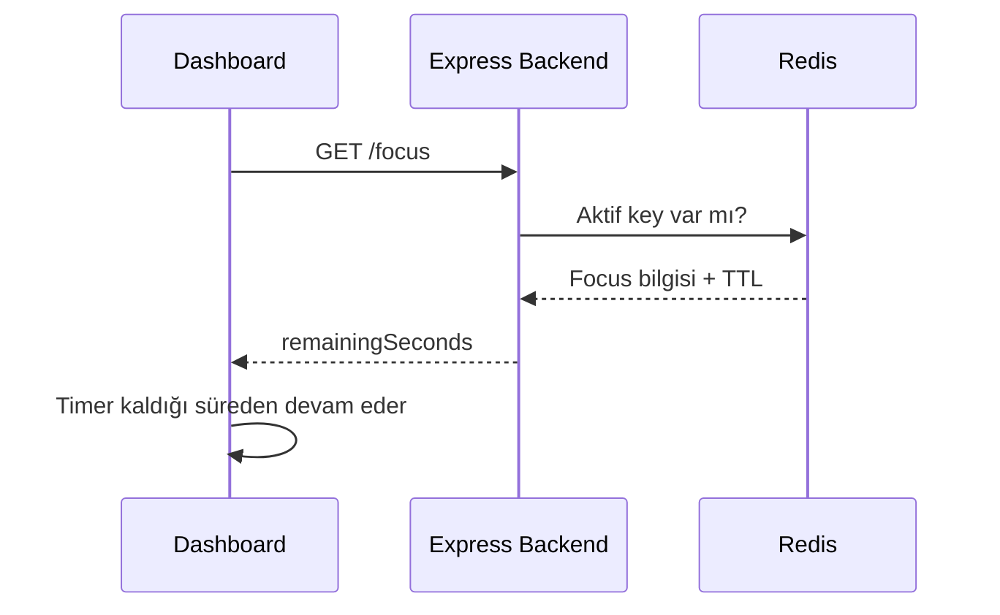

Bu yapı sayesinde sayfa yenilendiğinde focus timer sıfırlanmaz.

Redis sistemde aktif oturum için source of truth görevi görür.

---

## 15. Focus Durdurma Akışı

Kullanıcı aktif focus oturumunu durdurduğunda:

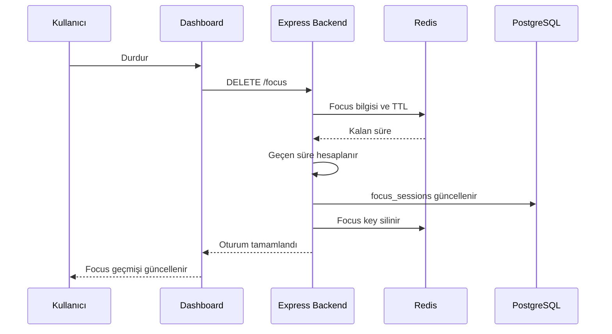

Geçen focus süresi PostgreSQL üzerinde kalıcı hale gelir.

Dashboard daha sonra bu kayıtları kullanarak:

```text
Bugünkü toplam odak süresi
Son odak oturumları
```

bilgilerini gösterir.

---

## 16. PostgreSQL ve Redis Ayrımı

İki veri sistemi farklı amaçlar için kullanılır.

### PostgreSQL

Kalıcı ve ilişkisel veriler:

```text
users
tasks
focus_sessions
```

### Redis

Geçici ve hızlı erişilmesi gereken aktif state:

```text
aktif focus oturumu
aktif task
kalan süre
TTL
```

Özet:

```text
PostgreSQL = Kalıcı veri
Redis      = Geçici aktif state
```

Redis PostgreSQL'in yerine kullanılmamaktadır.

İki servis farklı sorumluluklara sahiptir.

---

## 17. Lokal Development Mimarisi

Lokal geliştirme Windows ve VS Code üzerinde gerçekleştirilmiştir.

Frontend:

```text
Next.js
localhost:3000
```

Backend:

```text
Node.js / Express
localhost:5000
```

Backend, PostgreSQL ve Redis Docker container'ları içerisinde çalıştırılabilir.

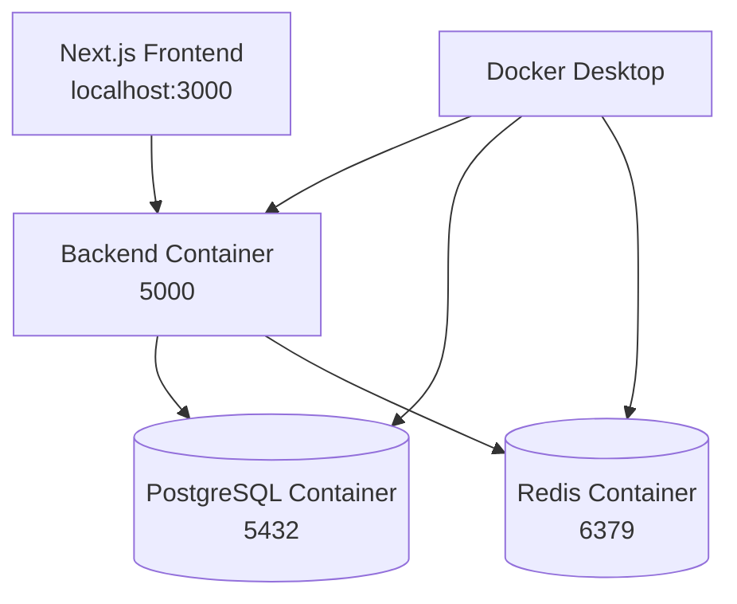

Docker Compose yapılandırması:

```text
docker-compose.yml
```

dosyasında bulunur.

Servisler:

```text
backend
postgres
redis
```

olarak tanımlanmıştır.

Tüm servisleri başlatmak için:

```bash
docker compose up -d --build
```

kullanılır.

---

## 18. Docker Compose Haberleşmesi

Docker Compose servisleri aynı Docker network içerisinde bulunur.

Bu nedenle backend PostgreSQL'e:

```text
localhost
```

yerine:

```text
postgres
```

hostname'i ile ulaşır.

Redis'e ise:

```text
redis
```

hostname'i ile ulaşır.

Örnek yapı:

```text
Backend
   |
   +---- postgres:5432
   |
   +---- redis:6379
```

Bu servis isimleri:

```text
docker-compose.yml
```

içerisinde tanımlanmıştır.

---

## 19. Production Mimarisi

Production ortamında Docker Desktop kullanılmaz.

Servis dağılımı:

```text
Frontend   -> Vercel
Backend    -> Railway
PostgreSQL -> Railway
Redis      -> Railway
```

Production mimarisi:

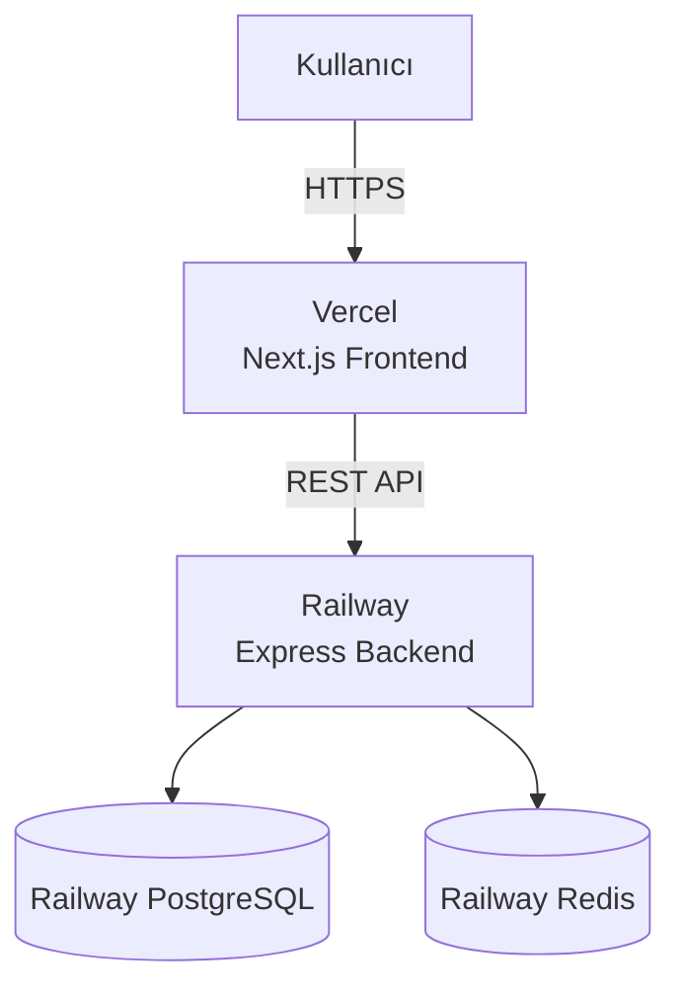

Backend Railway tarafından verilen public domain üzerinden erişilebilir.

Frontend bu domain'i environment variable üzerinden kullanır.

---

## 20. Environment Variables

Servis adresleri ve secret değerler kaynak kod içerisine doğrudan yazılmaz.

### Frontend

```text
NEXT_PUBLIC_API_URL
```

Frontend'in hangi backend'e bağlanacağını belirtir.

Lokal:

```text
http://localhost:5000
```

Production:

```text
Railway backend public domain
```

### Backend

Production ortamında temel environment variable'lar:

```text
DATABASE_URL
REDIS_URL
JWT_SECRET
```

Görevleri:

```text
DATABASE_URL
→ PostgreSQL bağlantısı

REDIS_URL
→ Redis bağlantısı

JWT_SECRET
→ JWT oluşturma ve doğrulama
```

Production değerleri Railway Variables bölümünde tutulur.

Secret değerler GitHub repository içerisinde tutulmaz.

---

## 21. Production Database Initialization

Railway üzerinde oluşturulan PostgreSQL başlangıçta boş bir veritabanıdır.

Tabloların oluşturulması için:

```text
backend/init.sql
```

dosyası kullanılır.

Bu SQL dosyasını çalıştıran script:

```text
backend/init-db.js
```

dosyasıdır.

Railway üzerinde Pre-deploy Command:

```bash
node init-db.js
```

olarak ayarlanmıştır.

Akış:

```text
Deployment başlar
      ↓
node init-db.js
      ↓
init.sql okunur
      ↓
PostgreSQL tabloları kontrol edilir
      ↓
Backend başlatılır
```

Tablolar:

```sql
CREATE TABLE IF NOT EXISTS
```

mantığıyla oluşturulur.

---

## 22. Git ve GitHub Akışı

GitHub uygulamanın runtime request akışının parçası değildir.

GitHub kaynak kod ve deployment sürecinde kullanılır.

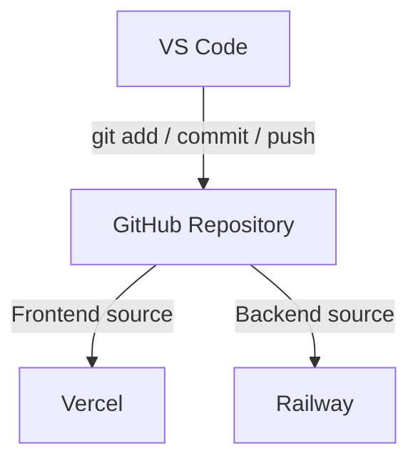

Repository yapısı:

```text
focustrack/
├── frontend/
├── backend/
├── docs/
└── docker-compose.yml
```

Frontend ve backend aynı repository içerisinde bulunduğu için proje monorepo yapısındadır.

Deployment sırasında:

```text
Vercel Root Directory  = frontend
Railway Root Directory = /backend
```

olarak yapılandırılmıştır.

---

## 23. Development ve Production Karşılaştırması

| Katman | Development | Production |
|---|---|---|
| Frontend | localhost:3000 | Vercel |
| Backend | localhost:5000 / Docker | Railway |
| PostgreSQL | Docker Container | Railway PostgreSQL |
| Redis | Docker Container | Railway Redis |
| Kod | VS Code | GitHub kaynaklı deploy |

Kod yapısı aynıdır.

Environment variable'lar sayesinde farklı ortamlarda farklı servis adresleri kullanılabilir.

---

## 24. Uçtan Uca Uygulama Akışı

FocusTrack'in temel çalışma akışı:

```text
1. Kullanıcı Vercel üzerindeki frontend'i açar.

2. Next.js kullanıcı arayüzünü gösterir.

3. Kullanıcı register veya login işlemi yapar.

4. Frontend REST API üzerinden Railway backend'e request gönderir.

5. Backend authentication işlemini gerçekleştirir.

6. Login başarılıysa JWT oluşturulur.

7. Frontend JWT'yi saklar.

8. Kullanıcı dashboard üzerinden görev işlemleri gerçekleştirir.

9. Frontend korunan request'lerde JWT'yi Bearer token olarak gönderir.

10. Backend kullanıcıyı doğrular.

11. Task verileri PostgreSQL üzerinde işlenir.

12. Kullanıcı focus başlattığında PostgreSQL'de focus session oluşturulur.

13. Aktif focus bilgisi Redis'e TTL ile yazılır.

14. Frontend backend üzerinden kalan focus süresini alır.

15. Sayfa yenilense bile Redis TTL sayesinde timer devam eder.

16. Focus durdurulduğunda geçen süre PostgreSQL'e kaydedilir.

17. Redis'teki aktif focus key'i silinir.

18. Dashboard focus geçmişini ve günlük toplam süreyi gösterir.
```

---

## 25. Genel Özet

FocusTrack mimarisinin temel prensibi servislerin sorumluluklarının ayrılmasıdır.

```text
Next.js
→ Kullanıcı arayüzü

Express
→ API ve iş mantığı

PostgreSQL
→ Kalıcı veriler

Redis
→ Geçici aktif state

Docker Compose
→ Lokal servis yönetimi

GitHub
→ Kaynak kod ve versiyon kontrolü

Vercel
→ Production frontend

Railway
→ Production backend, PostgreSQL ve Redis
```

Nihai production akışı:

```text
Kullanıcı
   ↓
Vercel / Next.js
   ↓
REST API + JWT
   ↓
Railway / Express
   ↓
   ├── PostgreSQL
   └── Redis
```

Bu yapı ile frontend, backend ve veri servisleri birbirinden ayrılmış ve her katmana belirli bir sorumluluk verilmiştir.
